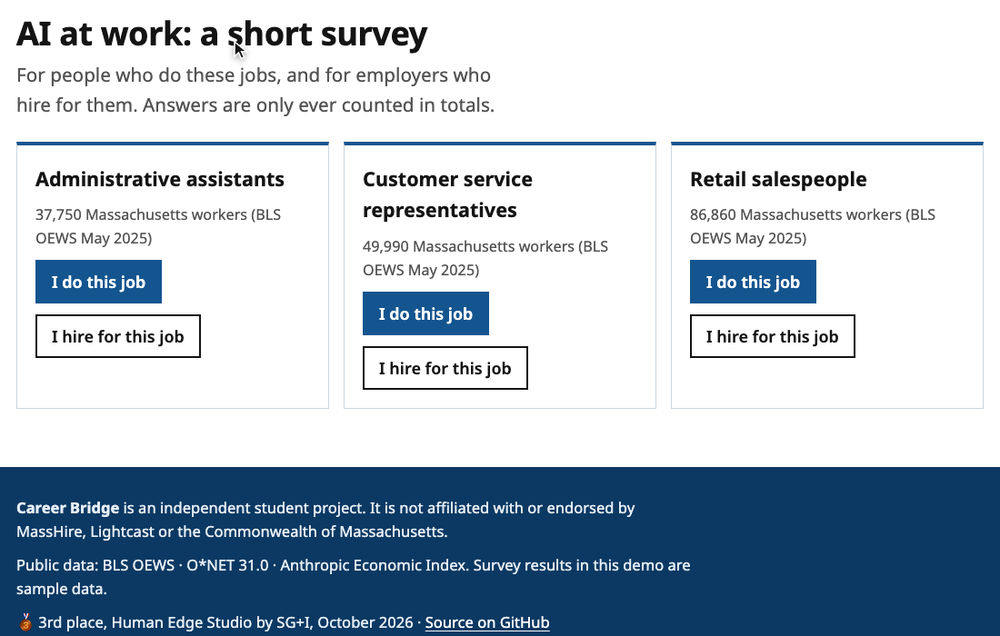
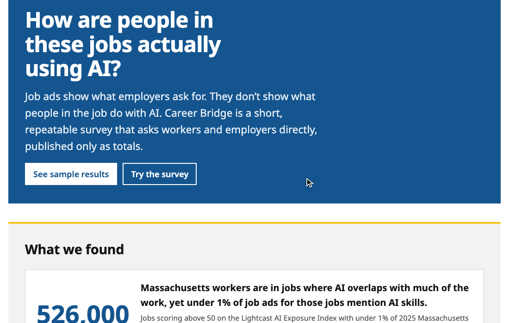
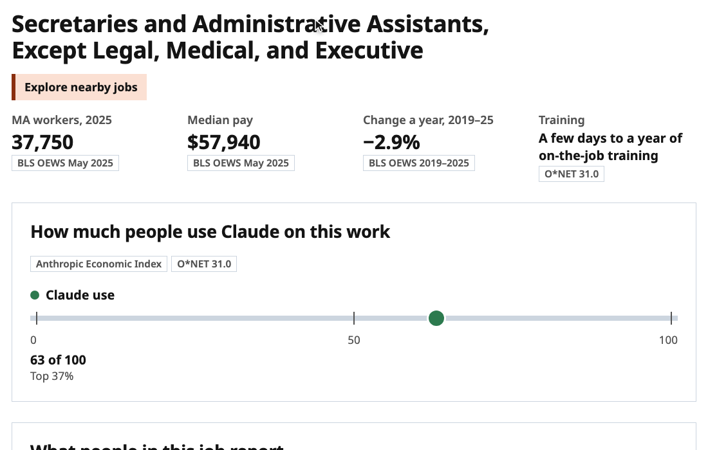

<p align="center"></p>

<h1 align="center">Career Bridge</h1>

<p align="center"><b>How are people in Massachusetts' silent-gap jobs actually using AI?</b><br>
A short, repeatable survey for workers and employers, published only as totals.<br>
<a href="https://scriblesean.github.io/career-bridge/"><b>Try the live demo →</b></a></p>

<p align="center"><b>3rd place, Human Edge Studio by SG+I</b> · October 24, 2026 · team The Communicators</p>

---

## What we found

About **526,000 Massachusetts workers** are in jobs where AI overlaps with much of the work, yet under 1% of job ads for those jobs mention AI skills. These are jobs that score above 50 on the Lightcast AI Exposure Index and where under 1% of 2025 Massachusetts job ads ask for any AI skill. Worker counts come from BLS OEWS May 2025.

Ads show what employers ask for. They don't show what people in those jobs do with AI. Maybe the jobs don't need AI skills, or maybe people already use AI and nobody is asking. Asking people tells the difference.

## The survey



- Workers take about five minutes. They say which work activities they do in a typical week and whether AI helps with each, which AI tools they use, whether they were trained, and what would help.
- Employers take about three minutes. They say what the role needs, what is becoming more important, whether their job ads mention AI, and whether they train people on AI.
- The questions use the work activities O\*NET lists for each job, so answers compare with O\*NET and Lightcast data for the same job. The survey adds three AI activities O\*NET doesn't track yet: using AI assistants, checking AI output, and automating routine tasks.
- The survey starts with three silent-gap jobs: administrative assistants, customer service representatives and retail salespeople.

## The results



The results page shows only totals by job and region, and it hides any group with fewer than 10 responses. The survey doesn't ask for names or company names. The page also shows where workers and employers differ, for example AI activities that employers say are becoming more important but few workers do yet. The workers in those gaps are the ones who could use AI training, such as the state's free courses.

## For career counselors



Look up any job to see its pay, growth, training, and how much AI is already used on the work (Anthropic Economic Index). The page also lists what to do more of, and jobs with similar skills along with the skills to build for each. Every number names its source: BLS OEWS, O\*NET 31.0 or the Anthropic Economic Index.

## Proposed pilot

The pilot would run for one quarter in one region, with that region's MassHire workforce board, on the three survey jobs. The goal is about 100 worker and 25 employer responses per job, collected through channels people already use. The board would get a short report it can use to target AI training, and a question set it can repeat every year.

## Status

Career Bridge is a working prototype. **All survey results in it are sample data**, made up to show how the totals would read. What you answer stays in your browser. Career Bridge is an independent student project and is not affiliated with MassHire, Lightcast or the Commonwealth of Massachusetts.

## Run it locally

You need Python 3.9+ with pandas, and the Human Edge Studio event dataset (BLS OEWS and Anthropic Economic Index extracts), which is not in this repo. Put it at `./sgi_dataset` or point `SGI_DATA` at it.

```sh
python3 -m venv .venv && . .venv/bin/activate
pip install pandas
python pipeline/atlas.py        # builds data/atlas.json and data/titles.json from open data
./demo.sh                       # serves the app at http://localhost:8000
```

To build the static site instead, run `./build-site.sh`, then `python3 -m http.server 8090 --directory site`.

If the licensed Lightcast files are in the dataset folder, `./demo.sh` also runs `pipeline/build.py` to add the Lightcast overlay (`data/careerbridge.json`). [`CONTRACT.md`](CONTRACT.md) describes the data files.

## Contributing

Issues and pull requests are welcome. Before you open a PR:

- Run `python -m unittest discover -s tests` and `node --test tests/`.
- Load the app, open the overview, the survey, the results, a job and About, and check that the console shows no errors.
- Don't commit anything under `data/` or `sgi_dataset/`. Lightcast data is licensed, and `build-site.sh` fails if `site/` would contain it.

With the app running, `node docs/media/record.mjs` records the README clips in headless Chrome. It needs no npm packages.
