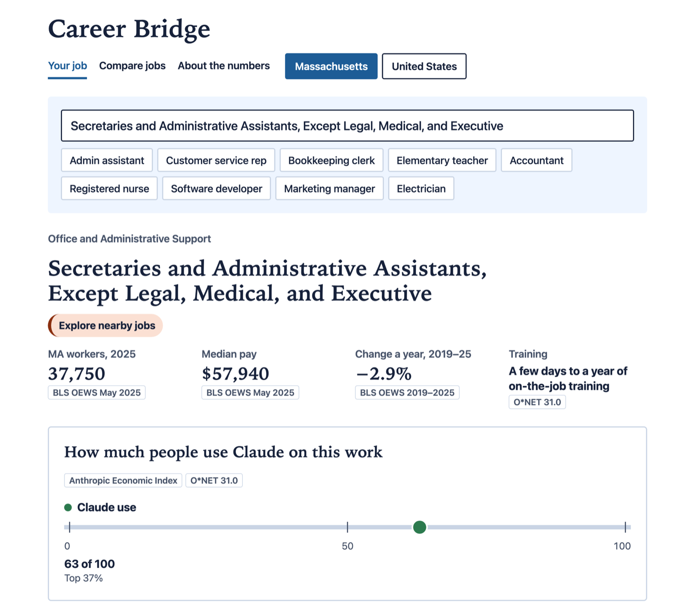
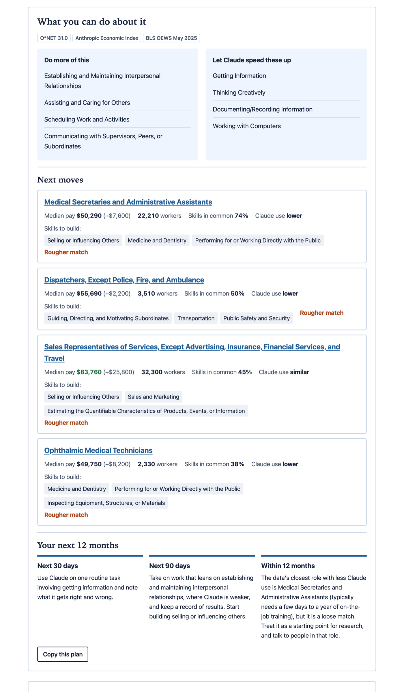
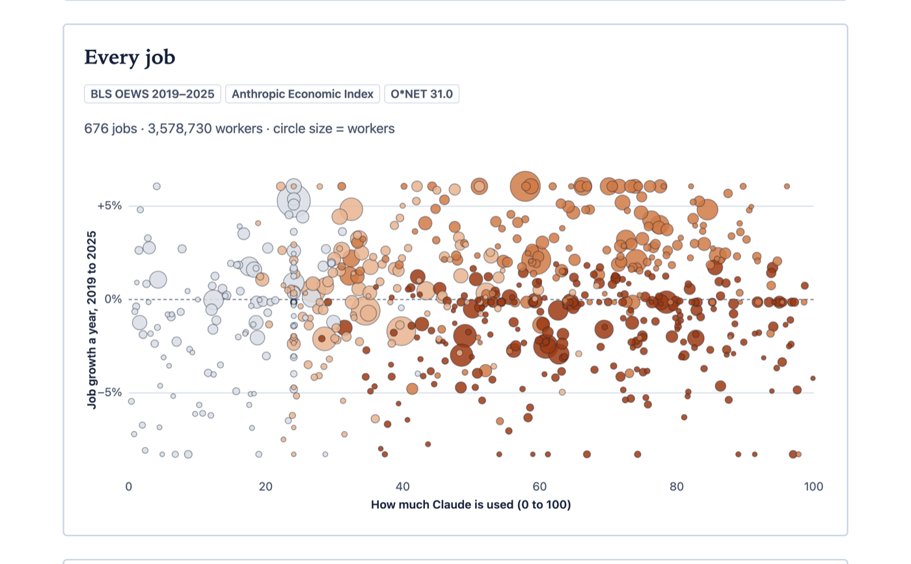
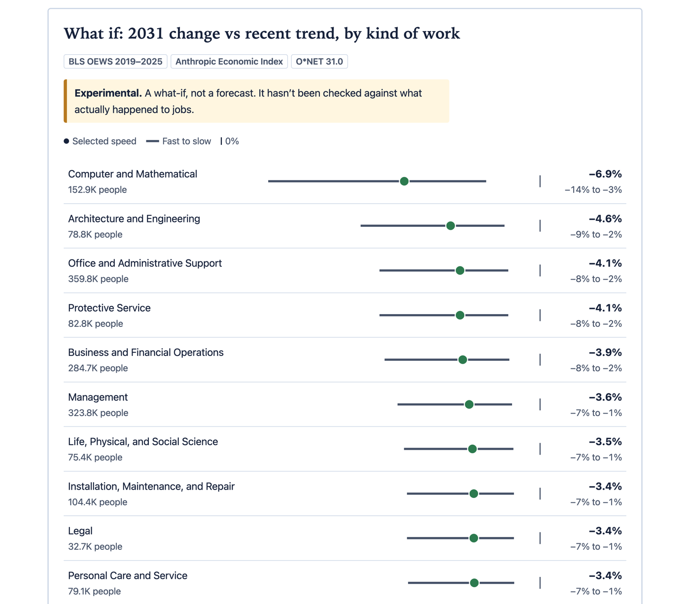

# Career Bridge

Career Bridge is a career tool for Massachusetts workers and workforce boards. Look up a job to see how much of its work people already hand to AI, how the job has been growing, and a concrete plan for what to do next.

🥉 **3rd place, Human Edge Studio by SG+I, October 2026.** Built by team **The Communicators** for the hackathon *Work, Identity, and Opportunity in the Age of AI*, at WPI on October 24, 2026.

## What it does

Type a job title or pick an example. Each job page shows:

- **The basics**: Massachusetts or US workers, median pay, yearly job change from 2019 to 2025, and the training it usually takes.
- **How much people use Claude on this work**: a 0–100 score from the Anthropic Economic Index, matched to the job's tasks in O*NET.
- **A plan**: the parts of the work to do more of, the parts Claude can speed up, nearby jobs with the skills to build for each, and a 30-day, 90-day and 12-month timeline you can copy.
- **A 2031 what-if**: slow, medium and fast AI adoption, with sliders to set your own numbers. It is marked experimental: a what-if, not a forecast.

## Features

**Compare jobs.** Every job on one chart, by how much Claude is used and how fast the job grew. Filter by kind of work, and sort the same data in a table.

**The what-if by kind of work.** How each occupation group could end 2031 compared with its recent trend, at the speed you pick, with the full range from fast to slow.

**With the licensed Lightcast data** (used at the event, not public):

- Two more rulers on each job: how much the work overlaps with AI (Lightcast AI Exposure Index) and how many Massachusetts job ads ask for AI skills, against the 6.18% state rate.
- Job-ad trends from 2023 to 2026, a check on whether the job is following software's path, and the top skills employers ask for.
- **For workforce boards**: Massachusetts workers in four groups by AI overlap and employer demand, with job change since 2019. Click a group, such as the *silent gap*, where under 1% of job ads ask for AI skills, to list every job in it.

**Built for everyone.** Plain language, large text, every number labeled with its source, a sortable table behind every chart, and full keyboard and screen-reader support. Switch between Massachusetts and the United States.

AI overlap shows where work overlaps with what AI can do. It does not predict job loss, and it can mean AI helps with the work.

Data: BLS OEWS (May 2019 to May 2025), O*NET 31.0, Anthropic Economic Index (June 2026 release), and Lightcast AI Exposure and Adoption by Occupation (Data Source: Lightcast, 2026; event build only).
