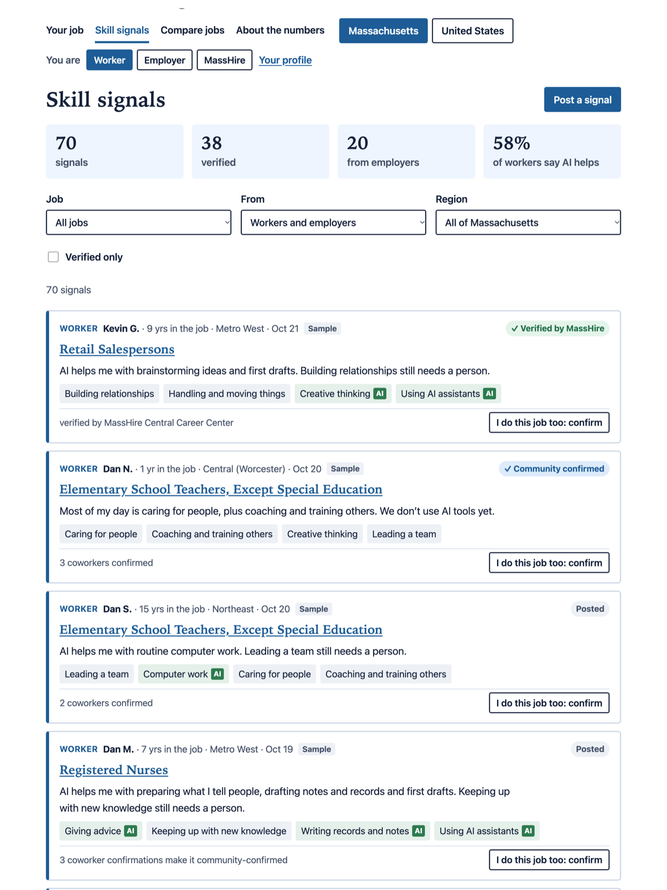
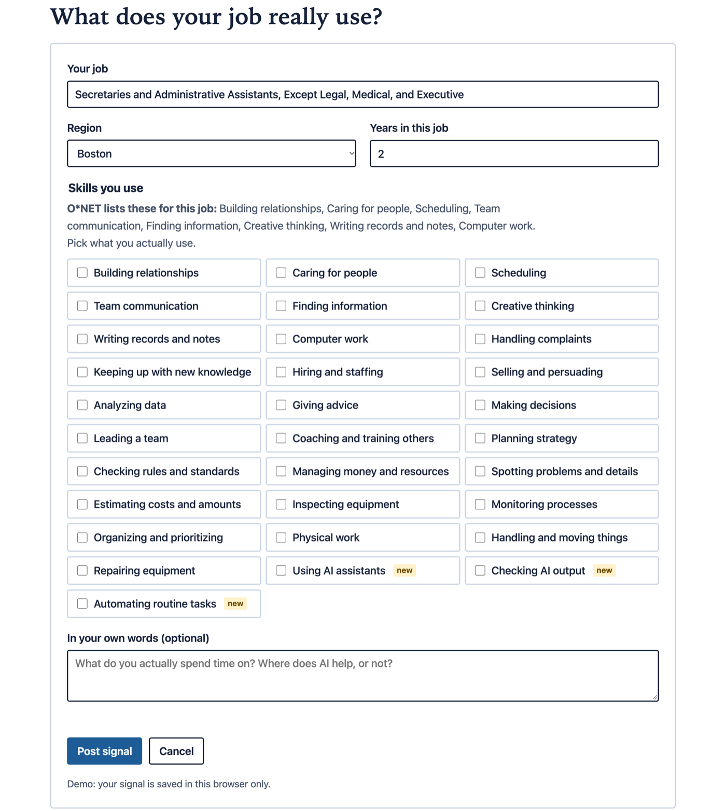
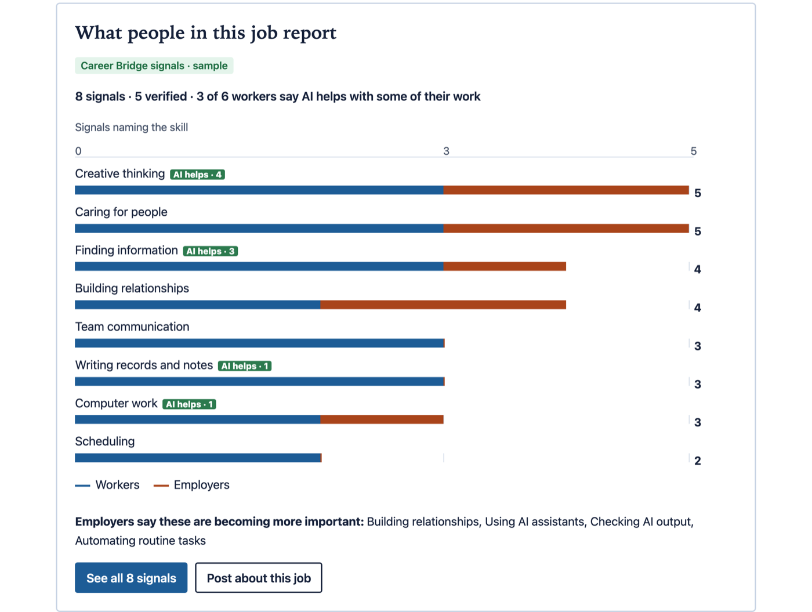

# Career Bridge

Career Bridge is where Massachusetts workers and employers say what jobs really involve. Workers post the skills their job actually uses and where AI helps. Employers post what a role needs and which skills are becoming more important. Coworkers, employers and MassHire career centers confirm what's true. Alongside it, every job comes with the public data: pay, growth, how much people use AI on the work, and a plan for what to do next.

🥉 **3rd place, Human Edge Studio by SG+I, October 2026.** Built by team **The Communicators** for the hackathon *Work, Identity, and Opportunity in the Age of AI*, at WPI on October 24, 2026.

## Why

Our hackathon analysis found a *silent gap*: about 526,000 Massachusetts workers are in jobs where AI overlaps with much of the work, yet under 1% of job ads for those jobs ask for any AI skill. Employers aren't signaling what they need, and workers can't tell what to learn. Job ads are a weak, slow signal. Career Bridge asks both sides directly.

## Skill signals

**Post a signal.** Pick your job, then tick the skills you really use and mark where AI helps. The list is built on O*NET work activities, with the ones O*NET lists for your job shown first, plus newer skills O*NET doesn't track yet, like *checking AI output*. Employers also mark which skills are becoming more important in the role.

**Confirm what's true.** Every signal starts as *Posted*. Three coworkers who do the same job make it *Community confirmed*. An employer or a MassHire career center can verify it. Nobody can confirm their own.

**See the job from both sides.** Each job page adds *What people in this job report*: the skills workers and employers name most, where AI helps, and what employers say is becoming more important.

**Switch sides.** Use the demo as a worker, an employer or a MassHire career center. Each has its own profile with the signals you posted, the ones you confirmed, and badges.

## The market view

Look up any job for the public data behind it:

- **The basics**: Massachusetts or US workers, median pay, yearly job change from 2019 to 2025, and the training it usually takes.
- **How much people use Claude on this work**: a 0–100 score from the Anthropic Economic Index, matched to the job's tasks in O*NET.
- **A plan**: the parts of the work to do more of, the parts AI can speed up, nearby jobs with the skills to build for each, and a 30-day, 90-day and 12-month timeline you can copy.
- **A 2031 what-if**: slow, medium and fast AI adoption, with sliders. Marked experimental: a what-if, not a forecast.

**Compare jobs.** Every job on one chart by AI use and growth, and the 2031 what-if by kind of work.

**Built for everyone.** Plain language, large text, every number labeled with its source, a sortable table behind every chart, full keyboard and screen-reader support, and it works on a phone.

## About this demo

The signals marked *Sample* are made up to show how it works. What you post or confirm is saved in your browser only and never sent anywhere. AI overlap shows where work overlaps with what AI can do; it doesn't predict job loss, and it can mean AI helps.

Run it: `./build-site.sh`, then `python3 -m http.server 8090 --directory site` and open http://localhost:8090.

Data: BLS OEWS (May 2019 to May 2025), O*NET 31.0, Anthropic Economic Index (June 2026 release). At the event we also used Lightcast job-ad data (Data Source: Lightcast, 2026), which is licensed and not part of this repo.
