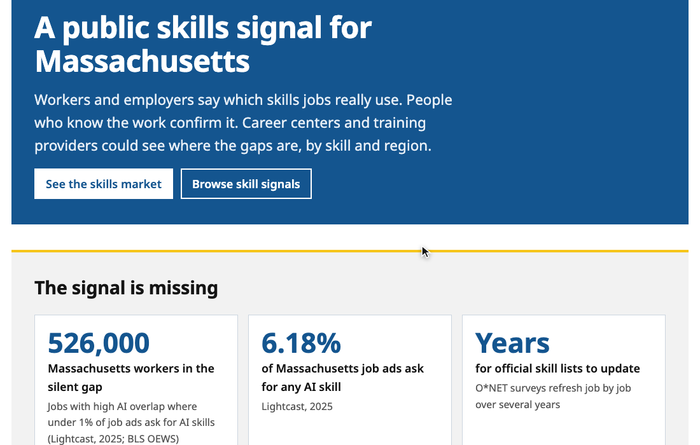
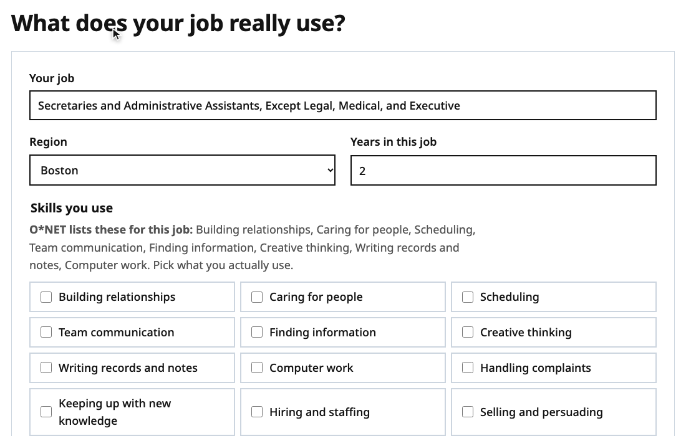

<h1 align="center">Career Bridge</h1>

<b>A public skills signal for Massachusetts.</b> 
Workers and employers say what jobs really use. People who know the work confirm it. 
<a href="https://scriblesean.github.io/career-bridge/"><b>Try the live demo →</b></a>

🥉 <b>3rd place, Human Edge Studio by SG+I</b> · WPI · October 24, 2026 · team The Communicators

---

## The problem

At the hackathon we found a **silent gap**: about 526,000 Massachusetts workers hold jobs where AI overlaps with much of the work, yet under 1% of the job ads for those jobs ask for any AI skill (Lightcast, 2025; BLS OEWS). Employers aren't saying what they need, so workers can't tell what to learn and training money can't tell where to go.

Career Bridge asks both sides directly, and lets the people who know the work check the answers.

## How it works

1. **Workers signal** which skills their job really uses, and where AI helps.
2. **Employers signal** what a role needs and which skills are becoming more important. A direct signal, not a job ad.
3. **People verify.** Three coworkers make a signal community-confirmed; an employer or a career center can verify it. Nobody confirms their own.
4. **The skills market adds it up:** employer demand against verified worker supply, by skill and region, with shortages flagged.

## Both sides, in the app

Post a signal as a worker, switch to the employer view, verify it, and see your profile and badges. The skill list is built on O*NET work activities, plus newer skills O*NET doesn't track yet, like *checking AI output*.

## Every job, from both sides

Each job page combines public data (pay, growth, how much people already use AI on the work, from BLS OEWS, O*NET 31.0 and the Anthropic Economic Index) with what workers and employers report, and a plan: what to do more of, what AI can speed up, and nearby jobs with the skills to build.

## The vision

Career Bridge is proposed as free, shared public infrastructure for the Massachusetts workforce system: no ads, no selling data, one open skills vocabulary, and only totals by skill and region made public. A first step would be a 90-day pilot in one region with three silent-gap jobs (administrative assistants, customer service representatives, retail salespeople).

## Status

This is a working demo. **Every signal and verification in it is sample data**, generated to show how it works; what you post stays in your browser. Career Bridge is an independent student project and is not affiliated with MassHire or the Commonwealth of Massachusetts. AI overlap shows where work overlaps with what AI can do; it doesn't predict job loss.

Run it locally: `./build-site.sh`, then `python3 -m http.server 8090 --directory site`. The README clips are recorded from the real app with `node docs/media/record.mjs` (headless Chrome, no dependencies).
